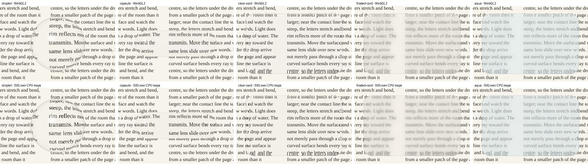

# One optical surface specification — v1 (2026-11-25)

Material Laboratory only. G1b and report-rs production integration stay blocked until the
approved Aqua Glass appearance is reached. Spec: `crates/a2ui-paint/src/optics/surface.rs`
(module doc is the normative text). Page: `/lab/optics/surface` (`/lab/optics/drop-gl`
opens it on the droplet preset).

## Parameter space (independent dimensions)

| dimension | field | query key |
|---|---|---|
| footprint aspect ratio | `Footprint::{width,height}` | `size` (shorter side), `aspect` |
| corner radius | `Footprint::corner` (fraction of half the shorter side) | `corner` |
| optical surface height | `Relief::height` (+ `base` slab) | `height`, `base` |
| face curvature | `Relief::face` (0 flat face, 1 dome over the inradius) | `face` |
| shoulder width and profile | `Relief::{shoulder, profile}` (`s(t) = (1−(1−t)^p)^(1/p)`) | `shoulder`, `profile` |
| refractive index | `Medium::{ior, abbe}`, dispersion exaggeration | `ior`, `abbe`, `medium`, `disp` |
| scattering | `Scatter::{direct, fine, wide, fine_sigma, wide_sigma}`, normalized weights | `direct`, `fine`, `wide`, `fsig`, `wsig` |
| body colour | `Tint` | `tint`, `tinta` |
| illumination | `KeyLight` | `light`, `elev`, `shine`, `spec`, `rim` |

`Surface::from_query` / `Surface::to_query` are the one parameter contract: the server's
SVG maps, the wasm renderer and the page controls all read it, and preset values exist only
in Rust (the page fetches `/lab/optics/surface/params?preset=…`). Presets (`droplet`,
`capsule`, `clear-card`, `frosted-card`, `aqua`) are parameter sets; there is no morph
parameter and no per-shape code. The droplet preset reproduces `Droplet::surface` exactly
(test). The card lab's `Glass` (`/lab/optics`) still has its own bevel model; retiring it
onto `Surface` is open.

## Three backends, one specification

- **CPU reference**: `Surface::{point, relief_at, offsets, sample_points, coverage}`.
- **SVG** (Chromium): `Surface::render_maps` → displacement (green-normalized, per-channel
  filter scales), highlight and rim PNGs; fine / wide `feGaussianBlur` mixed with
  `feComposite arithmetic` by the normalized weights from the server; tint as the element's
  background. Encoding error against the reference (`Surface::svg_map_error`, reported in
  `x-a2ui-svg-error`): p50 0.03–0.08, p99 0.06–0.15, max 0.07–0.19 px for the presets.
- **WebGL2** (`a2ui-optics-gl`, raw WebGL2, no wgpu): `surface.frag` evaluates the same
  formulas; `SurfaceUniforms` is computed from the `Surface`. Scattering: nine taps on a ring
  of radius σ at mip level `log2 σ − 1` (the page texture is mipmapped). The scattered terms
  sample at the green position (dispersion of a blur is not visible). The blur kernels are
  backend-specific and not part of the parity check; the geometry, coverage and dispersion
  are.

## Parity (headless Chromium, SwiftShader)

`SurfaceRenderer::parity()` reports two halves that are judged separately (OPT-8,
2026-11-25). A geometry error moves the picture and a photometric error changes its tone;
neither half can absorb the other's error.

**Geometry** (`geometry.float`, `geometry.texel`): (1) the shader's own sample positions and
coverage through a debug mode into an RGBA32F target, against `Surface::sample_points` /
`coverage`; (2) the real texture path over a 256² coordinate texture, exact texel per channel.

| preset | interior error px p50 / p99 / max (R=G=B) | edge position max | edge coverage max | leak | texel mismatch / off-by-one |
|---|---|---|---|---|---|
| droplet | 0 / 1.5e-5 / 2.2e-5 | 2.2e-5 | 0 | 0 | 0 / 0 |
| clear-card | 0 / 3.1e-5 / 3.4e-5 | 2.1e-4 | 0 | 0 | 0 / 0 |
| clear-card, dispersion ×12 | same per channel | 2.1e-4 | 0 | 0 | 0 / 0 (control 632) |
| aqua | 0 / 3.1e-5 / 3.4e-5 | 1.9e-4 | 0 | 0 | 0 / 0 |

Shader-disable runs (each restored afterwards; the restored run is back to the table):

| disabled | caught by |
|---|---|
| shoulder exponent `1/p` → `1/(p+0.25)` | interior max 0.23 px on cards; droplet unchanged (it has no shoulder); texel check only 20 off-by-one |
| red channel uses the green index | red max 0.44 px at dispersion ×12, 0 at ×0; texel 272 off-by-one |
| coverage ramp `0.5 − sd` → `0.45 − sd` | edge coverage max 0.05 |

**Photometric** (`photometric`): the real shading path (mode 0, RGBA32F) over a page of one
uniform colour, `rgb(40, 96, 168)`. Over a uniform page, refraction and the scattering
kernels cannot change the value, so this isolates tint, Fresnel rim, reflection and
highlight. The CPU reference is `Surface::shade_over`, which mirrors the shader's order.
Errors are in 1/255 per channel. Each control leaves one term out of the CPU reference and
must disagree clearly, which proves the check can see that term; it is `null` where the
preset does not use the term.

| preset | interior max r / g / b (1/255) | edge max | leak | controls: tint / rim / reflection / highlight |
|---|---|---|---|---|
| droplet | 0.0025 / 0.0018 / 0.0010 | 0.00002 | 0 | – / 20.7 / – / 193.7 |
| capsule | 0.0020 / 0.0015 / 0.0008 | 0.00002 | 0 | – / 6.6 / – / 193.8 |
| clear-card | 0.0003 / 0.0003 / 0.0001 | 0.0004 | 0 | – / – / 68.4 / 70.9 |
| frosted-card | 0.0003 / 0.0003 / 0.0001 | 0.0004 | 0 | – / – / 68.4 / 70.9 |
| aqua | 0.0002 / 0.0002 / 0.0001 | 0.0003 | 0 | 58.3 / – / 44.7 / 50.8 |

Disable runs prove the halves are independent. Each shader edit was restored afterwards, and
the restored run matches the tables.

| disabled | geometry | photometric |
|---|---|---|
| Fresnel exponent `5 → 4` | unchanged | droplet max 4.7, aqua max 11.9 /255 |
| tint opacity `× 0.9` | unchanged | aqua max 5.8 /255; droplet (no tint) unchanged |
| red channel uses the green index (dispersion ×12) | red max 0.44 px, texel 272 off-by-one | identical to baseline |

One disable run first passed unnoticed: the page ignores `disp` in the URL, so the dispersion
never applied and the run measured nothing. It was redone through the page's own control.

The first float run read back zeros: the target texture was also bound for sampling, WebGL
refused the draw (feedback loop) and the error was silent. The report now carries `gl_error`
and `nonzero` so that cannot pass as agreement.

## Measurements (headless Chromium, SwiftShader software WebGL, not a GPU)

Renderer string as reported: `ANGLE (Google, Vulkan 1.3.0 (SwiftShader Device (Subzero)), SwiftShader driver)`.
Phone = 390×844 viewport emulated at DPR 3 on the same CPU; no real phone, no real GPU.
Frames GPU-synced (one-pixel readback); mean over 120 moving frames.

| preset | DPR | shaded px / frame | % of page | mean | p95 |
|---|---|---|---|---|---|
| droplet | 1 | 186×186 = 34,596 | 3.4 | 3.4 ms | 3.9 ms |
| capsule | 1 | 276×96 = 26,496 | 2.6 | 2.6 ms | 3.8 ms |
| clear card | 1 | 326×206 = 67,156 | 6.6 | 5.5 ms | 7.0 ms |
| frosted card | 1 | 67,156 | 6.6 | 16.8 ms | 21.5 ms |
| aqua | 1 | 67,156 | 6.6 | 17.8 ms | 21.0 ms |
| droplet | 3 | 546×546 = 298,116 | 10.1 | 25.6 ms | 29.8 ms |
| capsule | 3 | 816×276 = 225,216 | 7.6 | 17.3 ms | 22.7 ms |
| clear card | 3 | 966×606 = 585,396 | 19.8 | 43.7 ms | 53.9 ms |
| frosted card | 3 | 585,396 | 19.8 | 137.8 ms | 172.9 ms |
| aqua | 3 | 585,396 | 19.8 | 133.4 ms | 166.2 ms |

- Idle: 0 GPU frames and 0 map requests in 1 s without input, on both viewports.
- Startup: wasm 181.6 KiB; fetch + compile + instantiate 25–28 ms; context + shader compile
  146–191 ms. Page texture with mips 5.2 MiB (1280×800) / 15.1 MiB (1170×2532 at DPR 3).
- The scattered presets cost ~3× the clear one per pixel (18 extra taps). Under software GL
  that is the dominant cost; on a GPU it is unmeasured.
- CPU maps (SVG path, release): 3.7–11.7 ms per map set; each pixel evaluates the surface
  twice. Not optimized; no ndarray (not measured as a bottleneck yet).

**Correction of the #65 report:** 544×544 against 184×184 is 8.74× the pixel area, not "about
30 % more". Every figure here states the shaded pixel count and DPR with it.

## Multi-surface: what was investigated (reading, not yet measured)

- A WebGL2 context belongs to one canvas, and browsers cap live contexts per page (Chromium
  drops the oldest past its limit). One context per surface does not scale to rails, buttons
  and windows.
- Options, each with one page texture uploaded once:
  1. **One overlay canvas, one context.** All surfaces drawn into a viewport-sized canvas with
     a scissor per dirty rect. Redrawing only dirty rects needs `preserveDrawingBuffer: true`
     (otherwise the compositor may discard the buffer and every frame is a full clear and
     redraw of all surfaces). Memory: viewport × DPR² × 4 B, doubled with a preserved buffer
     (≈ 24 MB at 1170×2532).
  2. **One offscreen context, per-surface `bitmaprenderer` canvases.** Render a surface into an
     `OffscreenCanvas`, `transferToImageBitmap`, hand it to that surface's canvas
     (`transferFromImageBitmap`). One context, per-surface canvases follow the DOM layout; a
     moved surface re-renders only itself.
  3. A small fixed pool of contexts (current state is a pool of one).
- Dirty regions: a moved surface invalidates its old and new box; a changed page texture
  invalidates every surface over it. Option 2 makes the invalidation unit the surface.
- Next probe: option 2, measuring transfer cost per frame against option 1's scissored redraw,
  with 1, 4 and 16 surfaces at DPR 1 and 3.

## Live scene (not solved, not to be solved by a second browser)

The GPU path needs the scene as a texture. There is no live, cheap texture of DOM content.
Native DOM optics (SVG backdrop filter) stays the path for ordinary HTML; the programmable
path applies where A2UI owns the scene raster (graph, maps, a2ui-paint raster, this lab's
page canvas), plus `drawElement`-style APIs behind a feature check where they exist.

## Visual acceptance sequence

Droplet → capsule → clear card → frosted card → aqua: top row WebGL2, bottom row SVG over the
CPU maps, same parameters. Not yet accepted; Aqua is a candidate, not the approved appearance.

## Material ownership (steps C and D, 2026-11-25)

G1b accepted in full (neutral glass, diffuse rear light, prismatic light). The materials now
live in `a2ui-theme`: Elevation and Frosted in `themes.css`, Holo Glass and Holo V2 in
`holo-glass.css`, and Holo V3 (`holo-v3/holo-v3.css`) and Aqua Glass
(`aqua-glass/{aqua-glass.css, aqua-sidecar.js, aqua-studio.js}`) moved from report-rs byte for
byte. They are five distinct designs plus the Holo V2 default. Each keeps its own rules and
none goes through `Surface` or another material's mechanism. `MATERIALS` registers them all,
`DEFAULT_MATERIAL` is `holo-v2`, and `SLIDER_MATERIALS` orders the appearance sidecar's
material slider (default first). The accepted Aqua Glass stylesheet is frozen byte for byte
(`crates/a2ui-theme/tests/aqua_glass_frozen.rs`, references in
`crates/a2ui-theme/tests/visual/`). The GPU path in this document (`Surface`, `a2ui-optics-gl`)
stays separate research and does not feed the accepted native DOM material.

## The GPU renderer ships in the Railway image (OPT-2, 2026-11-25)

`Dockerfile.pwa.railway` (the `a2ui-pwa` service) now builds `a2ui-optics-gl` to wasm in the
builder stage and ships the package as files (`/app/optics-gl-pkg`, served through
`OPTICS_GL_PKG`). The wasm-bindgen CLI is the prebuilt release that matches the crate version in
the Cargo.lock the image build itself resolves. The image keeps floating its dependencies without
a committed lock, so a pinned CLI would drift. `build-optics-wasm.sh` checks the versions again,
and a failed wasm build fails the image. The steps were reproduced locally on a fresh copy with a
newly resolved lock (wasm-bindgen 0.2.130). The server then served the package from
`OPTICS_GL_PKG` (200, `application/wasm`, 187,667 B), and `/lab/optics/drop-gl` drew its GPU
canvas without errors. `Dockerfile.railway` (the non-PWA image) is unchanged.
